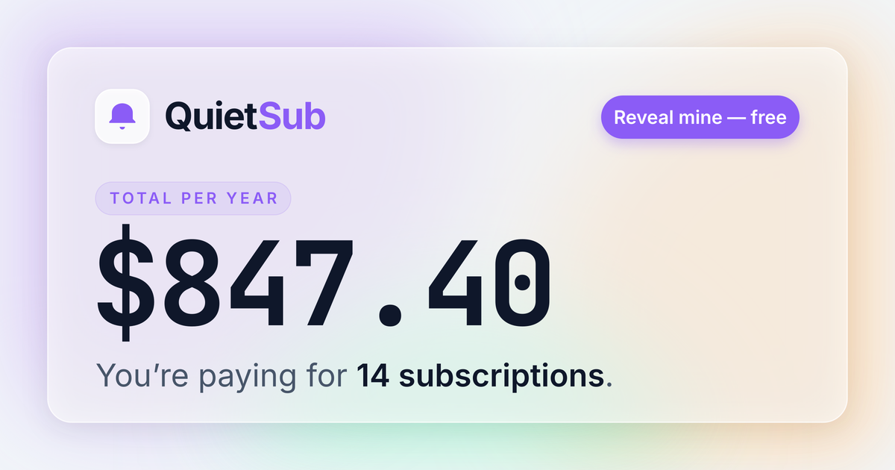

# QuietSub: Subscription Tracker

**Track all your subscriptions, get renewal reminders, and see exactly how much you spend monthly and yearly.**

QuietSub is a mobile app available on iOS and Android that helps you track every recurring subscription you pay for. Add your services yourself, get a reminder before each renewal, and see a spending dashboard with category breakdowns. No bank linking, no email scanning — just add your subscriptions and stay ahead of renewals.

- Website: https://quietsub.app
- App Store: https://apps.apple.com/us/app/quietsub-subscription-tracker/id6801977043
- Google Play: https://play.google.com/store/apps/details?id=com.quietsub.app

## Features

- Unlimited subscription tracking, free — no cap on how many you add
- Renewal reminder 3 days before every charge (Premium: choose 1, 2, 3, 5, 7, 14 or 30 days)
- Spending dashboard with monthly total, yearly projection and most-expensive ranking
- Categories (Streaming, Music, Cloud, Productivity, Fitness, Gaming, News, Education, Entertainment, Other) with a breakdown chart
- Weekly, monthly and yearly billing cycles
- One-tap cancel links to the cancellation page of 29 popular services (table below)
- Calendar of this month's renewals (Premium: past and future months)
- Trial Guard (Premium): mark a subscription as a free trial with the date it starts charging; the reminder then names the amount you're about to pay

## Pricing

- **Free:** unlimited subscriptions, reminder 3 days before renewal, monthly and yearly totals, categories and category chart, current-month calendar, cancel links. No ads.
- **Premium:** Trial Guard, custom reminder timing, 6-month spending trend, CSV export, full calendar. Monthly, yearly (with a 7-day free trial) or one-time lifetime; prices are shown in the app in your local currency.

## Where to cancel popular subscriptions

The same links QuietSub opens from a subscription's detail screen.

| Service | Category | Where to cancel |
|---|---|---|
| Netflix | Streaming | https://www.netflix.com/cancelplan |
| Spotify | Music | https://www.spotify.com/account/subscription/ |
| Apple Music | Music | https://apps.apple.com/account/subscriptions |
| YouTube Premium | Streaming | https://www.youtube.com/paid_memberships |
| Disney+ | Streaming | https://www.disneyplus.com/account/subscription |
| HBO Max | Streaming | https://www.max.com/account |
| Amazon Prime | Streaming | https://www.amazon.com/gp/primecentral |
| Hulu | Streaming | https://secure.hulu.com/account |
| Apple TV+ | Streaming | https://apps.apple.com/account/subscriptions |
| iCloud+ | Cloud | https://apps.apple.com/account/subscriptions |
| Google One | Cloud | https://one.google.com/settings |
| Dropbox | Cloud | https://www.dropbox.com/account/plan |
| Microsoft 365 | Productivity | https://account.microsoft.com/services |
| Adobe Creative Cloud | Productivity | https://account.adobe.com/plans |
| Notion | Productivity | https://www.notion.so/help/subscriptions-and-billing |
| Figma | Productivity | https://www.figma.com/settings |
| ChatGPT Plus | Productivity | https://help.openai.com/en/articles/6643004-how-do-i-cancel-my-chatgpt-plus-subscription |
| Claude Pro | Productivity | https://claude.ai/settings/billing |
| Peloton | Fitness | https://members.onepeloton.com/preferences/subscriptions |
| Strava | Fitness | https://www.strava.com/settings/subscription |
| Headspace | Fitness | https://www.headspace.com/settings |
| Calm | Fitness | https://www.calm.com/profile |
| Nintendo Switch Online | Gaming | https://accounts.nintendo.com/membership |
| Xbox Game Pass | Gaming | https://account.microsoft.com/services |
| PlayStation Plus | Gaming | https://www.playstation.com/account/ |
| The New York Times | News | https://myaccount.nytimes.com/seg/subscription |
| Medium | News | https://medium.com/me/settings |
| Duolingo Plus | Education | https://www.duolingo.com/settings/account |
| Skillshare | Education | https://www.skillshare.com/settings/account |

## About

QuietSub is made by DJUMP, MB — Šilutės pl. 35G-36, LT-94105 Klaipėda, Lithuania.
Privacy Policy: https://quietsub.app/privacy · Terms: https://quietsub.app/terms · Delete your account: https://quietsub.app/delete-account · Support: support@quietsub.app
